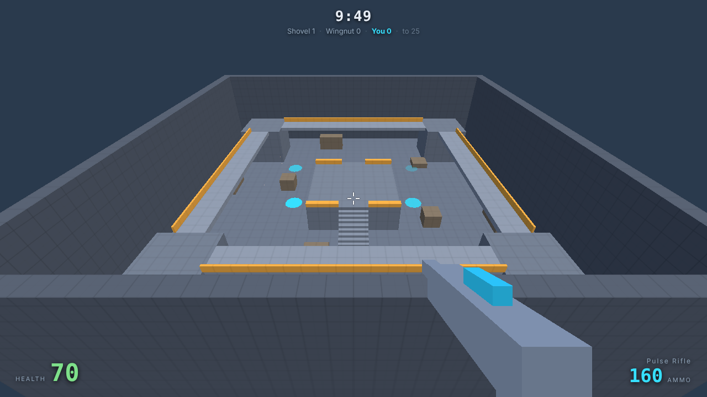

# Frag Zone: Discount Warfare

A browser arena shooter in the spirit of Unreal Tournament — fast, loud,
low-poly, and designed to run on a Chromebook. Built to play against bots
now, and against your brothers over peer-to-peer WebRTC later.



## Quick start

```bash
npm install
npm run dev          # http://localhost:5173
```

That is the whole setup. There is no asset pipeline and no server — the game
is static files, and the simulation runs in your tab.

| Command | What it does |
| --- | --- |
| `npm run dev` | dev server with hot reload |
| `npm test` | architecture guard + simulation tests (no browser needed) |
| `npm run smoke` | builds, opens real Chromium, plays a match, screenshots it |
| `npm run build` | production bundle into `dist/` |
| `npm run preview` | serve the production bundle locally |

`npm run smoke -- --ui` runs the same check with the browser visible, which is
the fastest way to watch the bots play without touching the keyboard.

## Controls

| | |
| --- | --- |
| **WASD** | move |
| **Space** | jump |
| **Mouse** | look, **click** to fire |
| **1** / **2** / wheel / **Q** | switch weapons |
| **Tab** | scoreboard |
| **R** | rematch |
| **Esc** | pause |

Rocket jumping works the way you hope: look at your feet, jump and fire. It
costs about 40 health and throws you roughly six metres up.

## Deploying

Pushing to `main` runs the tests and publishes `dist/` to GitHub Pages via
`.github/workflows/deploy.yml`. Enable it once under **Settings → Pages →
Source → GitHub Actions**. The build uses relative asset URLs, so it works
from a project subpath without configuration.

---

## How it is put together

Two rules shape everything, and both exist so that later milestones are
additions rather than rewrites.

### 1. Game logic never touches the renderer

```
src/engine/   simulation — no three.js, no DOM, plain {x,y,z} vectors
src/render/   three.js — reads snapshots, writes nothing back
src/client/   input, HUD, the loop that joins the two
src/data/     JSON loading and validation
```

`src/engine/` runs in Node. That is why the simulation has real tests, and it
is the precondition for a host running a match headlessly. The rule is
enforced, not just documented: `npm test` runs `tools/check-layering.mjs`,
which fails the build if anything under `src/engine/` imports `three`, reaches
into `src/render/`, or touches `document`.

The simulation takes **commands** in and emits **events** out. It never calls
into rendering, audio or UI; it appends plain serialisable events to a queue
the presentation layer drains each frame. A test asserts that a snapshot
survives a JSON round trip, because that queue is what a host will broadcast
to peers.

### 2. The host is the authority, and it is behind an interface

`src/engine/net/Host.js` defines five methods: `snapshot()`, `drainEvents()`,
`sendCommand()`, `sendHitClaims()` and `update()`. Nothing above that line
talks to `World` directly.

Today the only implementation is `LocalHost`, which owns a `World` in your
tab. Milestone 2 adds `PeerHost` (owns a `World`, broadcasts over WebRTC) and
`RemoteHost` (forwards commands to whoever is hosting). `Game.js` does not
change.

**Hit detection favours the shooter.** `fireWeapon()` resolves a shot on the
shooter's machine and returns hit *claims*; the host applies them, trusting
the target and the headshot flag, and re-derives only the damage ceiling from
the weapon JSON. That clamp is not anti-cheat — there are no cheaters here — it
just stops a bad weapon file deleting someone. Projectiles are the exception:
a travelling rocket has to agree for everyone, so the host simulates those.

**Bots are a command source.** `Bot.think()` returns the same object a
keyboard produces. The simulation cannot tell the difference, and the host can
run bots in a networked match with no special path.

### 3. Everything is data

Maps, weapons, characters, modes, mutators and bot difficulty are JSON files
under `public/data/`, fetched at runtime and validated on load. See
**[CONTENT.md](CONTENT.md)** for the full format of each.

Game modes are not classes. A mode is a bag of rule values; a mutator is an
ordered list of patches against that bag:

```json
{ "path": "gravityScale", "op": "mul", "value": 0.42 }
```

Stacking Low Gravity and Big Heads is applying two patch lists in sequence.
The lobby builds its mutator toggles by reading the manifest, so dropping a
new mutator JSON into `public/data/mutators/` makes it playable without
touching a line of code. A patch naming an unknown rule throws on load rather
than being ignored.

---

## What exists today (milestone 1)

- **One blockout arena** loaded from JSON: a 64×64 room with a raised centre
  platform, stairs, four corner towers joined by a ring walkway, jump pads and
  ground cover.
- **Two weapons.** A hitscan Pulse Rifle with falloff and headshots, and a
  Rocket Launcher with travel time, splash damage, line-of-sight occlusion and
  knockback.
- **Health, respawn, kill feed and scoreboard**, all driven by rule values.
- **Bots** with waypoint navigation (A* over a graph sampled from the map
  geometry), line-of-sight checks, and the two handicaps that make them
  beatable: a reaction delay before a freshly spotted target may be shot at,
  and an aim error cone that rotates rather than snapping. Three profiles
  measure roughly 6.6 / 16.6 / 33.2 damage per second at mid range.
- **Four mutators** — Low Gravity, Big Heads, Instagib, Rocket Arena — that
  stack in any combination.

### Performance notes

The target is integrated graphics. The arena merges into one draw call per
material, there are no shadow maps, no post-processing and no dynamic lights,
effects are pooled into shared buffers (all tracers are one `LineSegments`,
all sparks one `Points`), and the pixel ratio is capped. A typical frame is
about 18 draw calls and 500 triangles; the smoke test fails if draw calls go
above 60.

The simulation runs at a fixed 60Hz with the renderer interpolating between
ticks, so physics and bot behaviour do not change with frame rate.

## What is designed for but not built

The architecture leaves room for these; none of them are implemented yet.

- **P2P multiplayer** — `Host` interface, serialisable snapshots and events,
  shooter-resolved hit claims are all in place.
- **Raccoon horde mode** — would be a mode JSON plus an instanced-mesh actor
  view; the sim already treats bots as plain command sources.
- **Character designer** with photo-on-face — `appearance.faceTexture` is
  reserved in the character schema.
- **Weapons builder** with on-hit effects — `onHit: []` is reserved in the
  weapon schema.
- **Map editor and seeded generator** — `tools/gen-blockout-arena.mjs` already
  generates the shipped map, including sampling nav nodes off the geometry.
- **More game mode toggles** — add a JSON file.

## Layout

```
public/data/        the game's content, as JSON
src/engine/         simulation (renderer-free, Node-runnable)
  core/             RNG, event bus
  math/             vectors, AABBs, ray casts
  sim/              World, Arena, Actor, movement, weapons, damage, Match
  ai/               NavGraph (A*), Bot
  rules/            rule set and mutator patching
  net/              the Host interface multiplayer will implement
src/render/         three.js: arena, actors, view model, pooled effects
src/client/         input, HUD, lobby, the frame loop
tests/              simulation tests, run by `npm test`
tools/              map generator, layering guard, browser smoke test
```
